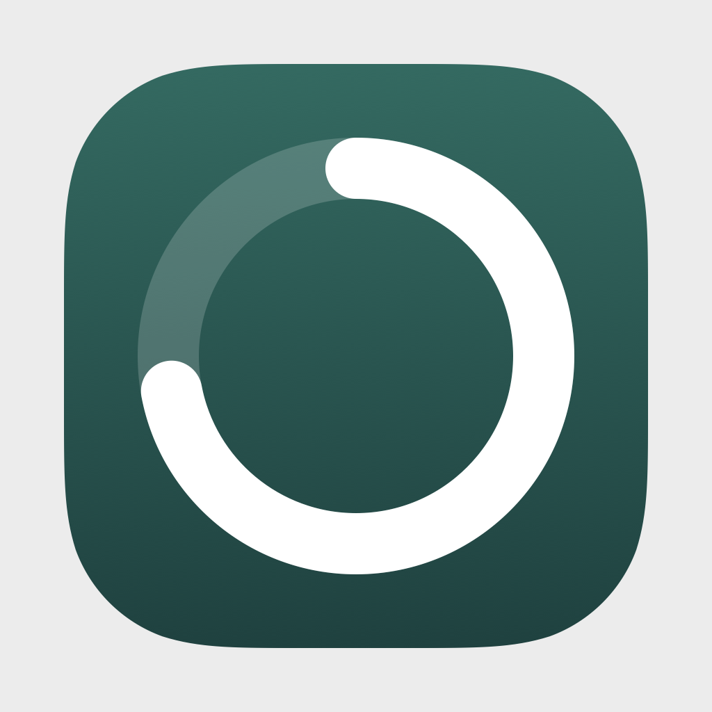
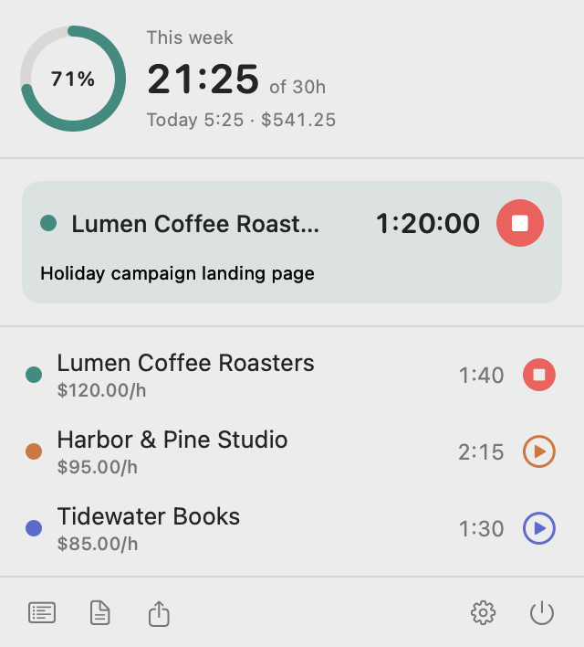
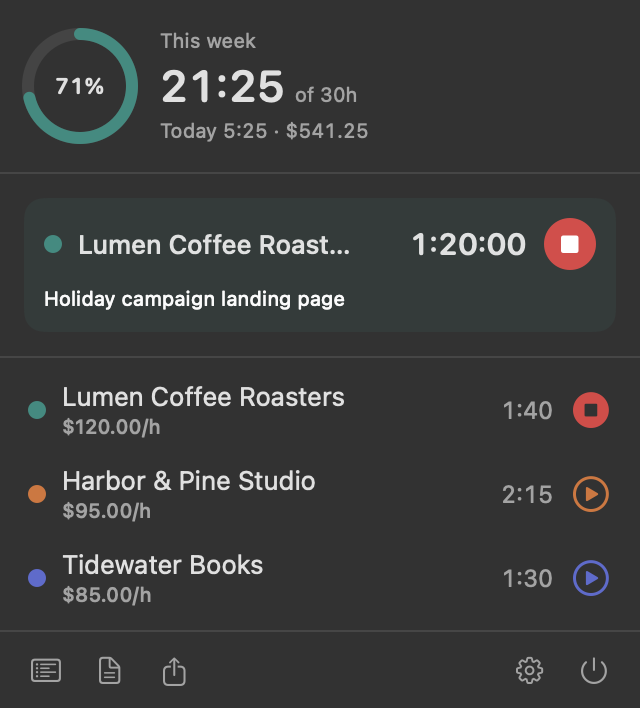
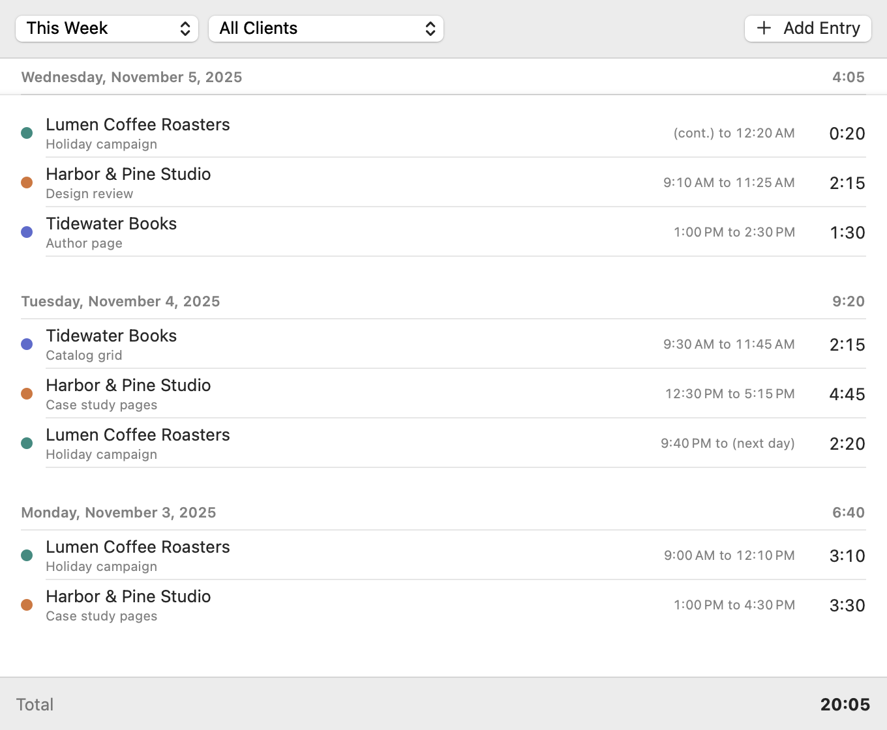
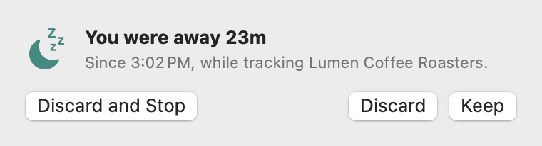
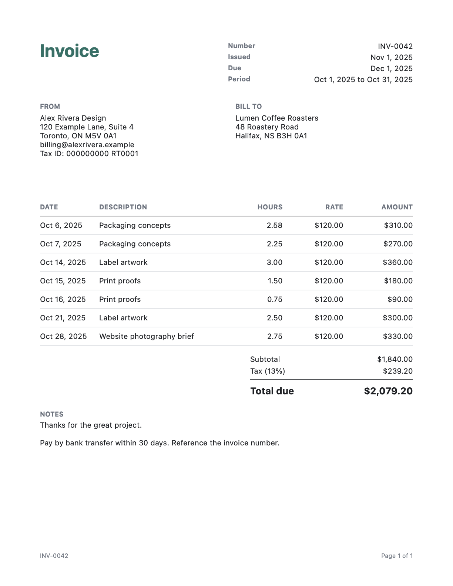

<p align="center">
  
</p>

<h1 align="center">TallyBar</h1>

<p align="center">
  A free, local-only time tracker for freelancers. It lives in the macOS menu bar.
  <br>One click to start, a real PDF invoice at the end of the month, no account.
</p>

<p align="center">
  
  
</p>

## The problem

Most time trackers want an account, a monthly fee and a copy of your client list on
someone else's server. For a solo freelancer the job is much smaller: know what you
worked on, know when you stopped, and turn it into an invoice.

TallyBar does that and nothing else. Your data is one JSON file on your Mac. The app
makes no network connections at all.

## What it does

- **One click per client.** Click a client to start. Click another to switch. Click
  again to stop.
- **Global hotkey.** Control-Option-Command-T starts and stops from anywhere, and it
  needs no Accessibility permission.
- **Idle detection.** "You were away 23m. Keep or discard?" Sleep and wake are covered,
  and so is a crash or power cut.
- **Rates and totals.** Per-client hourly rates and currencies, daily and weekly totals,
  and a weekly goal ring.
- **PDF invoices.** Drawn natively, with pagination, tax, payment terms and your details.
- **CSV export.** Correct quoting, spreadsheet formula protection, and timestamps that
  stay unambiguous during daylight saving changes.
- **Correct time math.** Sessions that cross midnight land on the right days. 23 and 25
  hour days add up. Money is `Decimal`, never a float.
- **Mac native.** SwiftUI, light and dark mode, VoiceOver labels, launch at login.

| Timesheet | Idle prompt |
| --- | --- |
|  |  |

## Install

### Download (Apple Silicon)

1. Download `Tallybar-<version>.zip` from the
   [Releases page](https://github.com/deanyool/tallybar/releases) and double-click it.
2. Drag `TallyBar.app` to `/Applications`.
3. Open it. Because the app is not notarized by Apple, macOS stops the first launch
   with "Apple could not verify TallyBar is free of malware". Click **Done**.
4. Open **System Settings > Privacy & Security**, scroll down to **Security**, and click
   **Open Anyway** next to the TallyBar message. Confirm with your password or Touch ID,
   then click **Open**. macOS remembers this, so later launches are normal.

If you prefer the terminal, this removes the download flag instead of steps 3 and 4:

```sh
xattr -dr com.apple.quarantine /Applications/TallyBar.app
```

The download is built for Apple Silicon and needs macOS 14 or later. On an Intel Mac,
build from source. Each release lists SHA-256 checksums in `SHA256SUMS`:

```sh
shasum -a 256 -c SHA256SUMS
```

### Build from source

You need macOS 14 or later and a Swift 6 toolchain: Xcode 16 or later, or the Command
Line Tools (`xcode-select --install`). There are no third-party dependencies.

```sh
git clone https://github.com/deanyool/tallybar
cd tallybar
scripts/build-app.sh
open dist/TallyBar.app
```

A Mac you build on trusts its own build, so there is no Gatekeeper step. Running the
tests needs Xcode, see [CONTRIBUTING.md](CONTRIBUTING.md).

## Quick start

A timer icon appears in your menu bar. There is no Dock icon. Open **Settings** from the
panel, add a client on the **Clients** tab, then click the client to start tracking.
Click it again to stop, or press Control-Option-Command-T from anywhere.

Turn on **Launch at login** in Settings to keep it running.

To confirm a build is healthy without clicking anything:

```console
$ scripts/smoke-test.sh dist/TallyBar.app
{
  "dataFile" : "/var/folders/tp/38zm1q1n41zc96wwwl_ltqn80000gn/T/tmp.IkOD1FngO9/ledger.json",
  "hotKeyHandlerFired" : true,
  "hotKeyRegistered" : true,
  "idleSeconds" : 543.786559334,
  "isAppBundle" : true,
  "launchAtLoginStatus" : "notFound",
  "ok" : true,
  "version" : "1.4.0"
}
Smoke test passed
```

`launchAtLoginStatus` is whatever macOS reports. A fresh build that has never been
registered reads `notFound`.

## Example output

An invoice, from the fictional ledger in `Sources/tally-render`
([PDF](docs/images/sample-invoice.pdf)):



The start of the CSV for the same month ([full file](docs/images/sample-export.csv)).
The session on the night of October 15 crosses midnight, so it is split across two rows:

```csv
date,start,end,hours,duration,client,note,rate,amount,currency,invoice
2025-10-06,2025-10-06T09:05:00-04:00,2025-10-06T11:40:00-04:00,2.58,2:35,Lumen Coffee Roasters,Packaging concepts,120.00,310.00,USD,
2025-10-15,2025-10-15T22:30:00-04:00,2025-10-16T00:00:00-04:00,1.50,1:30,Lumen Coffee Roasters,Print proofs,120.00,180.00,USD,
2025-10-16,2025-10-16T00:00:00-04:00,2025-10-16T00:45:00-04:00,0.75,0:45,Lumen Coffee Roasters,Print proofs,120.00,90.00,USD,
```

Every image and sample in this README is generated by `scripts/render-docs.sh`, which
draws the real views and the real invoice renderer. Nothing is mocked up.

## Settings

| Setting | Default | What it does |
| --- | --- | --- |
| Weekly goal | 30 hours | Target for the ring. 0 hides it. |
| Ask when idle for | 5 minutes | Quiet time before the away prompt. Never turns it off. |
| Week starts on | Monday | Used by weekly totals and the goal. |
| Global shortcut | ⌃⌥⌘T | Starts the last client, or stops the timer. Can be cleared. |
| Launch at login | Off | Uses `SMAppService`. Needs the built `.app`. |
| Round time to | Exact time | 1 to 30 minute increments, nearest or always up. |
| Default tax % | 0 | Prefills the invoice screen. |
| Payment terms | 30 days | Sets the due date. |
| Invoice prefix | `INV-` | Numbers run `INV-0001`, `INV-0002`, and so on. |
| Page size | US Letter | US Letter or A4. |

One environment variable is read at launch:

| Variable | What it does |
| --- | --- |
| `TALLYBAR_DATA_DIR` | Keeps `ledger.json` in this folder, for testing or a second ledger. |

## How it works

The app is split into a pure core and a thin UI. `TallyCore` holds the time math, money,
invoices, CSV and storage as plain Swift values with an explicit `now`, so every rule
runs in a test with no window or clock. `TallyUI` holds the SwiftUI views and the small
layer over macOS services.

The running session is saved the moment it starts, along with a heartbeat each minute.
After a crash or power cut, the next launch finds the session and asks about the gap.

Your data is written atomically to
`~/Library/Application Support/TallyBar/ledger.json`, with the previous version kept as
a backup. It is readable JSON, so it is yours to script, sync or back up.

More detail:

- [Architecture](docs/architecture.md)
- [Time math](docs/time-math.md): daylight saving, midnight and rounding
- [Data format](docs/data-format.md)

## Limitations

- **Not notarized.** The app has an ad-hoc signature only, so the first launch of a
  download needs the **Open Anyway** step above.
- **Apple Silicon download only.** Intel Macs can build from source.
- **One Mac.** There is no sync. The ledger is a file, so you can move it yourself, but
  two Macs writing to it at once will overwrite each other.
- **No team features.** One person, one ledger.
- **Idle detection sees input, not attention.** Reading a long document without touching
  the mouse counts as idle. That is what Keep is for.
- **Hotkey labels assume an ANSI layout.** The shortcut works on any layout, but the
  letter shown is the US key at that physical position.
- **Display follows your current time zone.** Entries store instants, not the zone you
  worked in, so durations never change, but a trip abroad shifts how old days are grouped.

## What is tested, and what is not

All of the time math, money, invoices, CSV and storage, plus everything the panel and
windows do (start, stop and switch clients, edit and delete entries, add and archive
clients, the export and invoice flows, keep or discard away time, the Launch at Login
switch), run in `swift test` against the real model with a stand-in save panel. The
views are rendered in tests to check that they lay out.

Some things only a person at the Mac can check, and are tested by hand before a release:

- clicking in the menu bar panel and the windows themselves,
- the system save panel (`NSSavePanel`),
- pressing the global shortcut on a real keyboard (`--self-check` registers it and
  sends a synthetic press through the same handler),
- Launch at Login actually starting the app after you log in,
- the away prompt after real sleep and wake.

## Contributing

Issues and pull requests are welcome. See [CONTRIBUTING.md](CONTRIBUTING.md) for setup
and project rules. The two that matter most: logic goes in `TallyCore` with a test, and
nothing goes on the network.

## License

[MIT](LICENSE)
